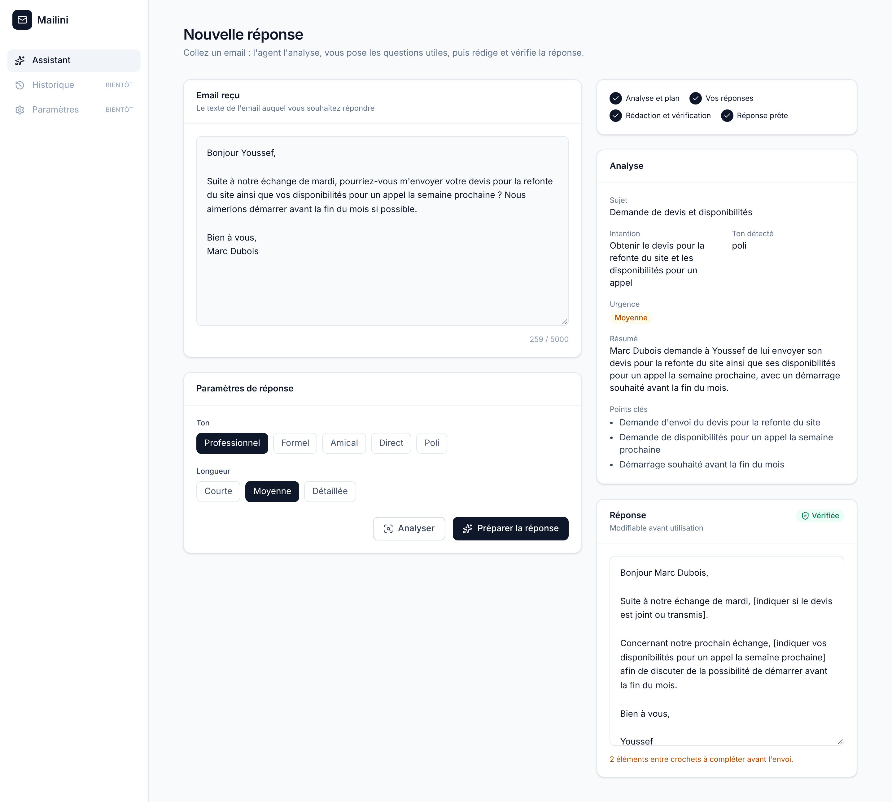
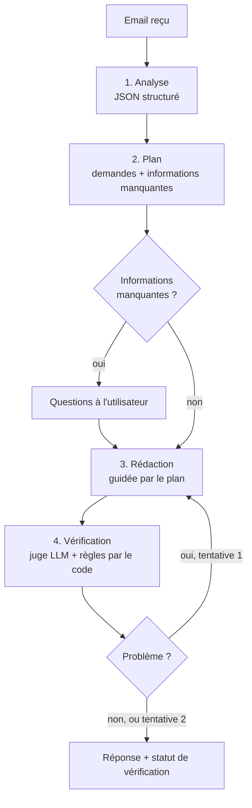
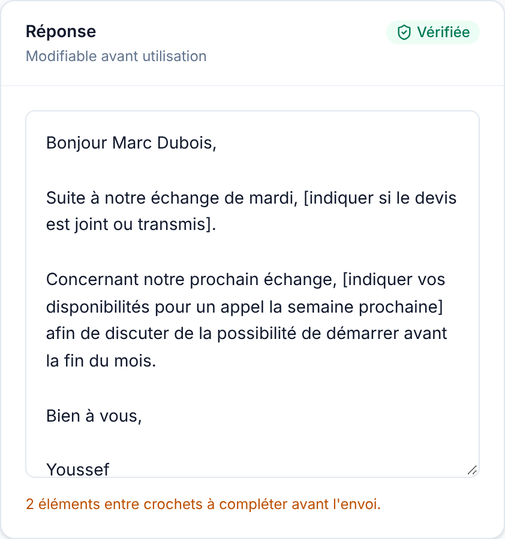

# Mailini — l'assistant email qui n'invente rien

Mailini est une application web qui aide à **comprendre un email reçu et à y répondre**. Elle s'appuie sur un **agent IA** : il analyse l'email, repère chaque demande, **pose des questions quand une information lui manque**, puis rédige une réponse et la **vérifie avant de la proposer**.

L'idée de départ est simple : un LLM appelé directement invente volontiers des faits (« vous trouverez ci-joint mon devis », « votre candidature est en cours d'examen »). Mailini est construit pour qu'il ne le fasse pas.



---

## Sommaire

- [Fonctionnalités](#fonctionnalités)
- [Fonctionnement de l'agent](#fonctionnement-de-lagent)
- [Architecture](#architecture)
- [Technologies](#technologies)
- [Installation](#installation)
- [Variables d'environnement](#variables-denvironnement)
- [API](#api)
- [Exemple](#exemple)
- [Sécurité et données personnelles](#sécurité-et-données-personnelles)
- [Limites connues](#limites-connues)
- [Améliorations prévues](#améliorations-prévues)

---

## Fonctionnalités

- **Analyse structurée** d'un email : sujet, intention, ton, niveau d'urgence, résumé et points clés.
- **Planification de la réponse** : chaque demande de l'expéditeur est listée, et l'agent indique ce qu'il peut traiter seul et ce qui demande une décision de l'utilisateur.
- **Questions à l'utilisateur** (*human in the loop*) : quand une information manque (un montant, une date, une décision), l'agent la demande au lieu de l'inventer. Une question laissée vide devient un espace réservé `[à compléter]`.
- **Rédaction** selon 5 tons (professionnel, formel, amical, direct, poli) et 3 longueurs.
- **Vérification automatique** de la réponse, avec réécriture si un problème est détecté (2 tentatives au maximum).
- **Réponse modifiable**, avec un compteur des éléments restant à compléter et un badge « Vérifiée » ou « À relire ».

---

## Fonctionnement de l'agent



| Étape | Rôle | Pourquoi elle existe |
|---|---|---|
| **Analyse** | Transforme l'email en données structurées (Zod + JSON Schema) | Les étapes suivantes consomment des données fiables, pas du texte libre. |
| **Plan** | Liste les demandes et ce qui manque pour y répondre | Sépare *ce qu'il faut dire* de *comment le dire*. Le modèle ne prend plus de décisions à la place de l'utilisateur. |
| **Questions** | Demande à l'utilisateur les informations manquantes | Un espace réservé visible vaut mieux qu'un fait inventé qui passe inaperçu. |
| **Rédaction** | Écrit la réponse à partir du plan et des réponses de l'utilisateur | Les réponses de l'utilisateur sont prioritaires sur le plan. |
| **Vérification** | Contrôle les demandes oubliées, les affirmations sans source, les contradictions et le ton | Un second appel au LLM (*LLM-as-a-judge*), complété par des règles déterministes (par exemple, une pièce jointe mentionnée sans que l'utilisateur l'ait indiquée). |

### Agent ou pipeline ?

Mailini est un **workflow agentique** :

- **Le système décide de la suite** à partir des résultats : s'arrêter pour poser des questions, accepter la réponse ou la réécrire.
- **La boucle est bornée**, et le résultat est toujours rendu, avec les problèmes signalés si la vérification échoue.
- **Les chemins possibles sont définis dans le code.** Le LLM ne choisit pas lui-même ses actions, comme le ferait un agent à *tool calling*. Ce choix rend le système prévisible, testable et moins coûteux.

Chaque exécution produit une **trace** (étapes, statut, durée) pour suivre le comportement de l'agent.

---

## Architecture

```
mailini/
├── front/                      React + Vite + Tailwind
│   └── src/
│       ├── components/
│       │   ├── ui/             Composants génériques (Button, Card, Alert…)
│       │   ├── email/          Composants métier (QuestionsPanel, AgentProgress…)
│       │   └── layout/
│       ├── pages/              ComposePage : orchestre l'état de l'écran
│       ├── services/           Appels HTTP vers l'API
│       └── constants/
│
└── back/                       Node.js + Express
    ├── src/
    │   ├── agents/             Orchestration : enchaînement, décisions, boucle, trace
    │   ├── services/           Compétences : une tâche LLM par fonction
    │   │   └── llm/            Client LLM (adaptateur compatible OpenAI)
    │   ├── prompts/            Prompts versionnés, séparés du code
    │   ├── schemas/            Zod : entrées de l'API ET sorties du LLM
    │   ├── controllers/  routes/
    │   ├── middlewares/        Validation, gestion d'erreurs, rate limiting
    │   └── config/             Variables d'environnement validées au démarrage
    └── tests/
        ├── agent.mjs           Script qui exécute l'agent de bout en bout dans le terminal
        └── fixtures/           Emails de référence
```

Quelques choix structurants :

- **Une seule source de vérité pour les schémas.** Le même schéma Zod sert de consigne au LLM (converti en JSON Schema) et de validation de sa réponse.
- **Un adaptateur LLM.** Le reste du code appelle `complete()` ou `completeJSON()` sans connaître le fournisseur. On passe de Gemini à OpenAI en changeant trois variables d'environnement.
- **Une API sans état.** Le plan est renvoyé au client puis revalidé côté serveur à l'étape suivante, donc pas besoin de base de données pour le flux de l'agent.

---

## Technologies

| Couche | Outils |
|---|---|
| Frontend | React 19, Vite, Tailwind CSS v4, lucide-react |
| Backend | Node.js 22, Express 5 |
| IA | API compatible OpenAI (Gemini ou OpenAI), Structured Outputs |
| Validation | Zod v4 |
| Sécurité | Helmet, express-rate-limit, validation des variables d'environnement |

---

## Installation

**Prérequis :** Node.js 20 ou plus récent, et une clé API [Google AI Studio](https://aistudio.google.com) ou [OpenAI](https://platform.openai.com).

```bash
git clone https://github.com/Youssef-Ounana/mailini.git
cd mailini

# Backend
cd back
npm install
cp .env.example .env      # puis renseigner LLM_API_KEY
npm run dev               # http://localhost:3001

# Frontend (dans un second terminal)
cd front
npm install
npm run dev               # http://localhost:5173
```

En développement, Vite redirige `/api` vers le backend, donc aucune configuration CORS n'est nécessaire.

**Tester l'agent sans l'interface :**

```bash
cd back
node tests/agent.mjs devis             # email de référence : demande de devis
node tests/agent.mjs relance formal    # paramètres : fixture, ton, longueur
```

---

## Variables d'environnement

Fichier `back/.env`. Le serveur **refuse de démarrer** si la configuration est invalide.

| Variable | Obligatoire | Exemple | Rôle |
|---|---|---|---|
| `LLM_API_KEY` | oui | — | Clé du fournisseur LLM. Jamais exposée au frontend. |
| `LLM_MODEL` | oui | `gemini-3.5-flash-lite` | Modèle utilisé. |
| `LLM_BASE_URL` | Gemini uniquement | `https://generativelanguage.googleapis.com/v1beta/openai/` | Point d'accès compatible OpenAI. À omettre pour OpenAI. |
| `PORT` | non | `3001` | Port du serveur. |
| `NODE_ENV` | non | `development` | `development`, `production` ou `test`. |

---

## API

Toutes les routes acceptent du JSON (100 Ko maximum) et sont limitées à 50 requêtes par 15 minutes et par IP.

| Méthode | Route | Corps | Réponse |
|---|---|---|---|
| `GET` | `/api/health` | — | État du serveur |
| `POST` | `/api/email/analyze` | `{ email }` | `{ analysis }` |
| `POST` | `/api/email/plan` | `{ email }` | `{ analysis, plan, needsUserInput, trace }` |
| `POST` | `/api/email/reply` | `{ email, tone, length, plan, answers }` | `{ response, verified, issues, attempts, trace }` |
| `POST` | `/api/email/generate` | `{ email, tone, length }` | `{ response }`, génération directe en un appel (sans agent) |

Les erreurs ont toujours la même forme :

```json
{ "error": { "code": "VALIDATION_ERROR", "message": "Données invalides", "details": [ … ] } }
```

---

## Exemple

**Email reçu :**

> Bonjour Youssef,
> Suite à notre échange de mardi, pourriez-vous m'envoyer votre devis pour la refonte du site ainsi que vos disponibilités pour un appel la semaine prochaine ? Nous aimerions démarrer avant la fin du mois si possible.
> Bien à vous, Marc Dubois

**Génération directe (un seul appel au LLM)**, sans plan ni vérification :

> « …vous prie de trouver **ci-joint** mon devis… »

Il n'y a aucune pièce jointe, et la demande sur le démarrage est ignorée.

**Avec l'agent**, qui repère 3 demandes et pose 3 questions. Sans réponse de l'utilisateur, il produit :

> Bonjour Marc,
> Suite à notre échange de mardi, [indiquer si le devis est joint ou transmis].
> Concernant notre prochain échange, [indiquer vos disponibilités pour un appel la semaine prochaine] afin de discuter de la possibilité de démarrer avant la fin du mois.
> Bien à vous,
> Youssef

Rien n'est inventé, et chaque élément manquant est visible.

| Questions de l'agent | Réponse vérifiée |
|---|---|
|  |  |

---

## Sécurité et données personnelles

Un email contient presque toujours des données personnelles de tiers. Mailini applique les principes suivants :

- **La clé API reste côté serveur.** Aucune variable `VITE_*` ne contient de secret, et `.env` est exclu de Git.
- **Toutes les entrées sont validées** avec Zod : types, longueurs, valeurs autorisées. Le plan renvoyé par le client est revalidé, car tout ce qui vient du navigateur est considéré comme non fiable.
- **Les sorties du LLM sont validées** avant d'être utilisées.
- **Le contenu des emails n'est jamais écrit dans les logs** : on n'y enregistre que les tokens consommés, les types d'erreurs et les durées.
- **Les injections de prompt sont limitées** : l'email est encadré par des balises et traité comme une donnée, les valeurs sont contraintes par des `enum`, et le vérificateur contrôle les engagements pris dans la réponse.
- **Rate limiting** contre les abus, qui protège aussi le budget API.

> **Attention, offre gratuite de Gemini :** Google peut utiliser les contenus envoyés pour améliorer ses produits. Utilisez uniquement des **emails fictifs** avec une clé gratuite. Avec une offre payante, Gemini comme OpenAI, les données de l'API ne servent pas à l'entraînement.

---

## Limites connues

- **Latence :** une réponse demande 4 à 6 appels au LLM. Sur l'offre gratuite de Gemini, cela peut prendre plus d'une minute.
- **Le vérificateur n'est pas infaillible :** un juge LLM peut laisser passer un problème. C'est pour ça qu'il est complété par des règles déterministes, et que la réponse reste modifiable.
- **Non-déterminisme :** le même email peut donner des plans légèrement différents d'une exécution à l'autre.

---

## Améliorations prévues

- [ ] Tests automatiques de l'agent sur les emails de référence (*evals*)
- [ ] Progression en temps réel des étapes (streaming SSE)
- [ ] Routage de modèles : un modèle léger pour analyser et vérifier, un plus puissant pour rédiger
- [ ] Modèle de secours en cas de surcharge du fournisseur
- [ ] Historique des emails (MongoDB) et authentification
- [ ] Régénération, traduction, correction d'un brouillon
- [ ] Détection de phishing dans l'analyse
- [ ] Tool calling, mémoire des préférences utilisateur, RAG sur des modèles de réponse
- [ ] Intégration Gmail / Outlook

---

## Auteur

**Youssef Ounana**, développeur full-stack.
[GitHub](https://github.com/Youssef-Ounana)
